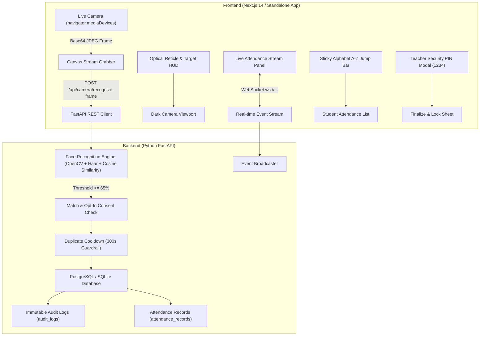

# 🎓 AlphabetAI Education Attendance System

A modern, full-stack, AI-powered biometric attendance management platform inspired by clean educational dashboards. Built with **Next.js 14 (TypeScript, Tailwind CSS)**, **Python FastAPI**, **PostgreSQL / SQLite**, and **OpenCV Biometric Face Recognition**.

AlphabetAI features alphabetical sorting (A–Z by first name by default), strict attendance integrity tied to immutable student UUIDs, live camera viewfinder overlays, real-time live attendance streams, duplicate scan prevention, explainable AI analytics, and teacher security PIN verification.

---

## 📸 System Architecture



---

## 🌟 Key Features

### 1. 📷 Real Live Webcam Access
- Direct integration with `navigator.mediaDevices.getUserMedia()`.
- Explicit controls: **Start Camera**, **Stop Camera**, and **Switch Camera** (cycles device IDs or toggles `user` / `environment` facing mode).
- Permission requests trigger strictly on user click ("Start Camera").
- Clean resource release: immediately stops all media tracks (`track.stop()`) on user stop or component unmount.
- Clear error handling for `NotAllowedError`, `NotFoundError`, and `NotReadableError` with built-in troubleshooting steps.

### 2. 🧠 Real AI Biometric Face Recognition
- Real computer vision using OpenCV Haar cascades to isolate face bounding boxes `(x, y, w, h)`.
- 128-dimensional canonical facial representation vector generated using normalized spatial gradient histograms.
- Cosine similarity matching against enrolled student biometrics:
  $$\text{Cosine Similarity} = \frac{\vec{u} \cdot \vec{v}}{\|\vec{u}\| \|\vec{v}\|}$$
- Strict **65% minimum confidence threshold** (`FACE_CONFIDENCE_THRESHOLD = 0.65`).
- **Unknown-Face Detection**: Any face detected in the camera frame below the confidence threshold is reported as unknown and never fakes recognition or attendance.
- **Opt-In Biometric Consent**: Only students with explicit biometric consent (`face_consent_given = true`) are matched.

### 3. 🛡️ Attendance Integrity & Duplicate Prevention
- **Cooldown Filter**: A configurable 5-minute cooldown (`DUPLICATE_ATTENDANCE_COOLDOWN_SECONDS = 300`) prevents repeated camera detections from duplicating database records or triggering redundant alerts.
- **Teacher Security Verification**: Sheets are finalized and locked into the audit trail using a 4-digit Teacher Security PIN (Default Demo PIN: `1234`).
- **Immutable Audit Trail**: Every recognition attempt, teacher override, bulk action, and sheet lock is logged with actor metadata.

### 4. 🔤 Smart A–Z Roster & Sticky Alphabet Jump Bar
- Alphabetical ordering by First Name (A–Z) by default.
- Sticky one-click Alphabet Jump Bar (`ALL`, `A`, `B` ... `Z`) displaying live student counts per letter.
- Flexible sorting options: First Name (A–Z / Z–A), Last Name (A–Z / Z–A), and Roll Number (01–99 / 99–01).
- Attendance statuses (`present`, `absent`, `late`, `excused`) are permanently anchored to unique immutable student UUIDs, preventing row-desynchronization when sorting or searching.

### 5. ⚡ Live Attendance Stream Panel
- Real-time side panel displaying incoming attendance events.
- Shows student roll badge, student name, status tag, confidence percentage pill, and relative timestamp.
- WebSocket streaming with graceful polling fallback.

### 6. 📊 Explainable AI Insights & Reports
- **Chronic Absence Detection**: Flags students dropping below institutional thresholds (< 75%).
- **Class Benchmark Progression**: Real-time turnout calculation compared to the 80% standard.
- **Explainable Basis & Math**: Collapsible breakdown showing the exact mathematical formula behind each AI insight.
- **Export CSV**: One-click RFC-compliant CSV report generator for administrative record-keeping.

---

## ⚡ Quickstart

### Option A: Zero-Dependency Instant Browser Preview (Recommended)
You can test the entire interactive camera, recognition, A–Z roster, teacher PIN verification, and live attendance stream immediately without installing Python or Node.js:
1. Double-click **`run_demo.bat`** (or open **`standalone-app.html`** directly in Google Chrome or Microsoft Edge).
2. Click **Start Camera** to test your webcam, face reticle overlays, A–Z filtering, teacher verification PIN (`1234`), and student registration.

---

### Option B: Docker Compose (Full Stack)
Run the entire production stack (PostgreSQL 16, Python FastAPI, Next.js 14) in isolated containers:

```bash
# Start all services
docker-compose up --build

# Services will be available at:
# Frontend Dashboard: http://localhost:3000
# Backend API & Docs: http://localhost:8000/docs
# PostgreSQL DB:      localhost:5432
```

---

### Option C: Manual Local Development

#### 1. Backend (Python FastAPI)
```bash
cd backend

# Create virtual environment
python -m venv venv
# Windows:
venv\Scripts\activate
# Linux/macOS:
source venv/bin/activate

# Install dependencies
pip install -r requirements.txt

# Run migrations & seed data automatically on startup
uvicorn app.main:app --host 0.0.0.0 --port 8000 --reload
```
API Documentation will be live at [http://localhost:8000/docs](http://localhost:8000/docs).

#### 2. Frontend (Next.js 14)
```bash
cd frontend

# Install packages
npm install

# Start development server
npm run dev
```
Open [http://localhost:3000](http://localhost:3000) in your browser.

---

## 🧪 Automated Testing

Run the pytest suite to verify authentication, camera frame recognition, duplicate prevention, and student enrollment:

```bash
cd backend
pytest
```

---

## 🔐 Security & Privacy Guardrails
1. **Zero Raw Photo Storage by Default**: Raw webcam image frames are decoded in memory, evaluated against mathematical biometric vectors, and immediately discarded.
2. **Opt-in Consent Enforcement**: Camera biometrics are never processed for students whose guardian has not explicitly provided consent.
3. **Teacher Verification Override**: Final attendance sheets require teacher authorization and PIN authentication before submission.
4. **HTTPS Enforcement**: In production environments, modern browser media APIs enforce secure SSL/TLS connections (`https://`) to protect webcam streams.
